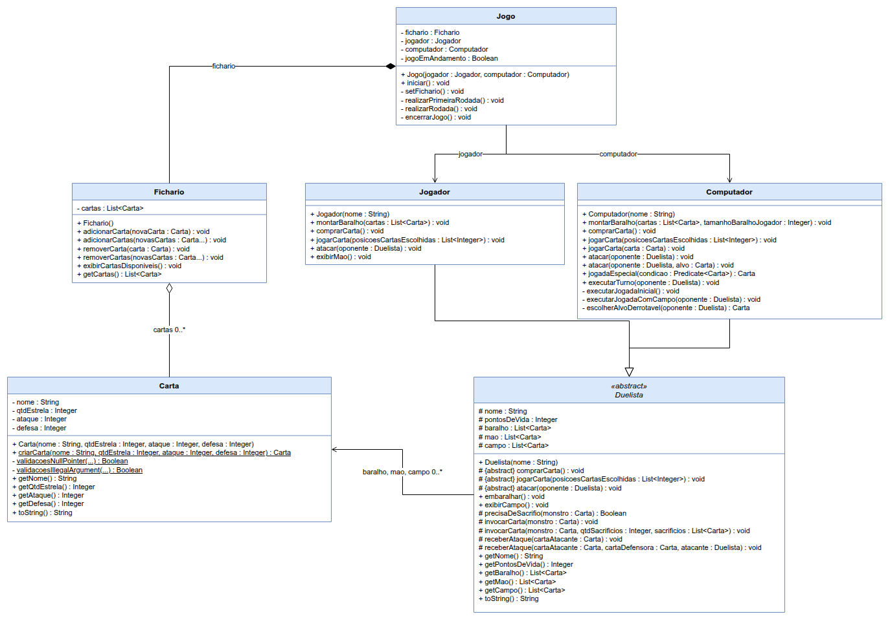

# Jogo Yu-Gi-Oh

Sistema de duelo de cartas por turnos, em Java (Maven), inspirado em Yu-Gi-Oh. Um jogador humano enfrenta o computador usando cartas com atributos de ataque, defesa e estrelas, invocando monstros e atacando o oponente até zerar seus pontos de vida.

> É uma versão bem simplificada do jogo: modela apenas as principais regras do duelo.

---

## Estrutura do projeto

```
src/main/java/school/sptech/
├── Main.java        # ponto de entrada: cria Jogador, Computador e inicia o Jogo
├── Jogo.java        # controla as rodadas e o fim do duelo
├── Fichario.java    # coleção de cartas disponíveis para montar os baralhos
├── Carta.java       # carta do jogo (nome, estrelas, ataque e defesa)
├── Duelista.java    # classe abstrata com as regras comuns de qualquer duelista
├── Jogador.java     # duelista humano (decisões via entrada no console)
└── Computador.java  # duelista automático (decisões por estratégia e sorteio)

src/test/java/school/sptech/   # testes unitários de cada classe
docs/                          # diagrama de classes (.drawio e .png)
```

## Classes

| Classe | Papel |
|--------|-------|
| `Jogo` | Reúne `Fichario`, `Jogador` e `Computador`; executa a primeira rodada, as demais rodadas e o encerramento. |
| `Fichario` | Guarda as cartas disponíveis; permite adicionar, remover e exibir cartas. |
| `Carta` | Imutável (sem setters). Só é criada pelo método de fábrica `criarCarta`, que valida os dados. |
| `Duelista` | **Abstrata.** Guarda nome, pontos de vida, baralho, mão e campo; implementa invocação, sacrifício e recebimento de ataques. |
| `Jogador` | Herda de `Duelista`; monta o baralho, compra, joga cartas e ataca conforme as escolhas do usuário. |
| `Computador` | Herda de `Duelista`; monta o baralho, compra, joga e ataca sozinho, executando o turno com base no estado do jogo. |

### Relacionamentos

- `Jogo` **compõe** um `Fichario` e se **associa** a um `Jogador` e a um `Computador`.
- `Fichario` **agrega** várias `Carta`.
- `Jogador` e `Computador` **herdam** de `Duelista`.
- `Duelista` se **associa** a várias `Carta` (baralho, mão e campo).

## Diagrama de classes



## Como executar

```bash
mvn test      # roda os testes
```

Para jogar, execute a classe `Main` pela IDE.
